# Screenshots

Captured from the running C++ server (`./DisasterManagementServer --port 8080`) with the
seeded databases — every number shown is computed by the backend.

**Theme:** emergency-command styling — crimson command bar with the brand, live-incident pill
and account avatar, navy navigation sidebar with a red pill for the active item, white
workspace, and amber / orange / green status accents (pending / in progress / completed).

## Public site

| Landing page | Sign in |
|---|---|
| 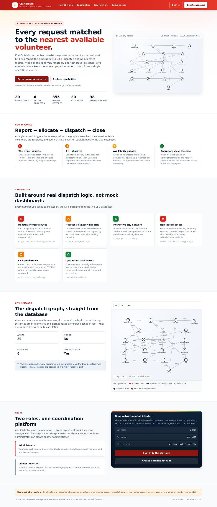 | 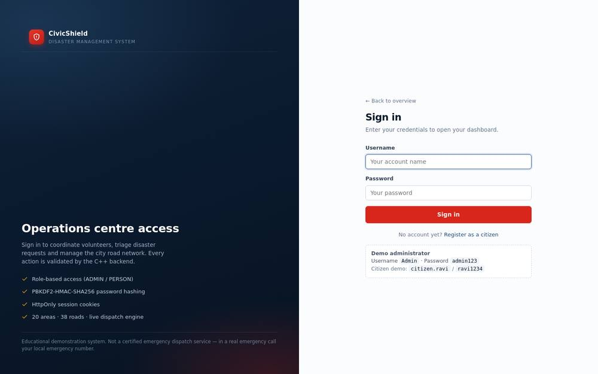 |

| Create a citizen account |
|---|
| 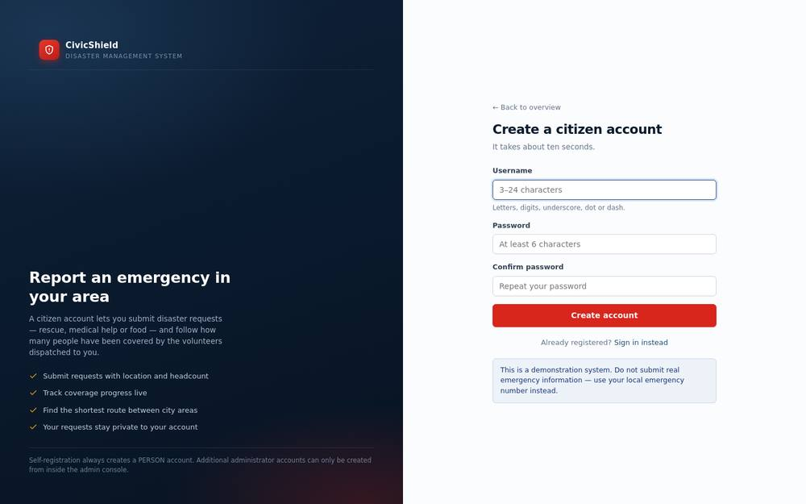 |

## Administrator console

| Dashboard | Volunteers |
|---|---|
| 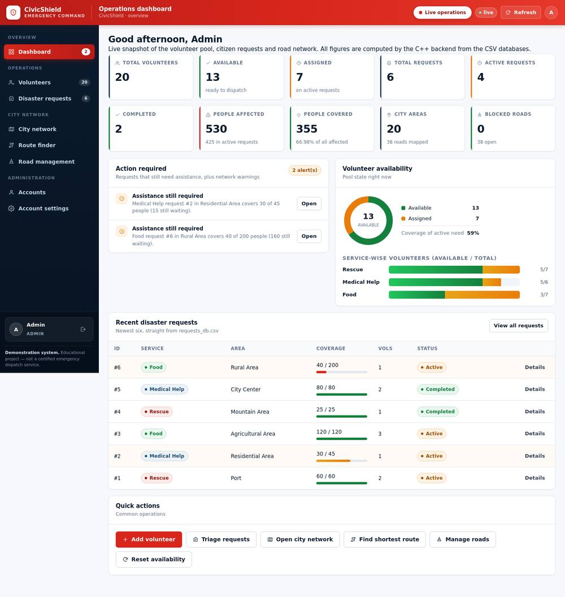 | 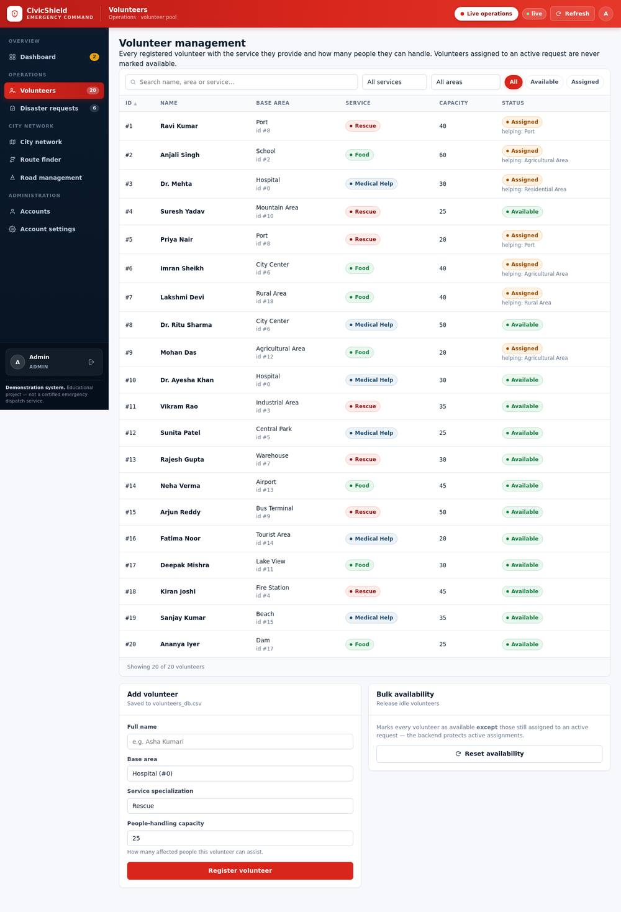 |

| Disaster requests | Request detail dialog |
|---|---|
| 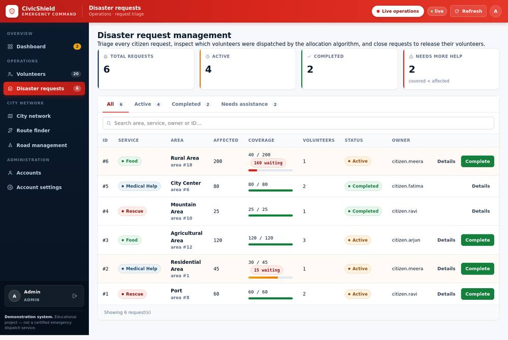 | 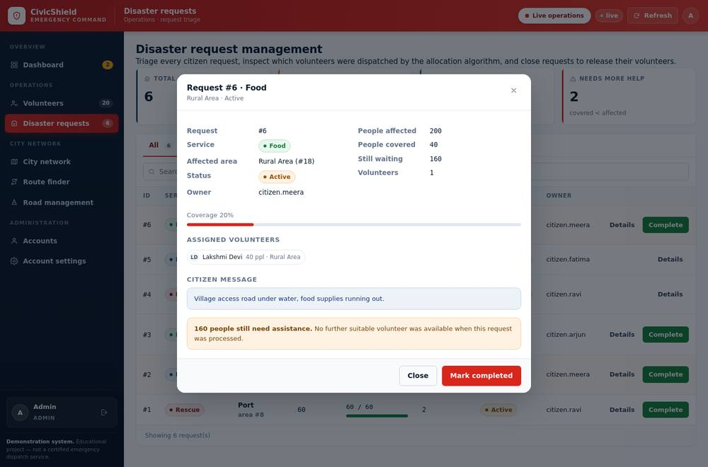 |

| City network (interactive map) | Shortest route + Dijkstra path |
|---|---|
| 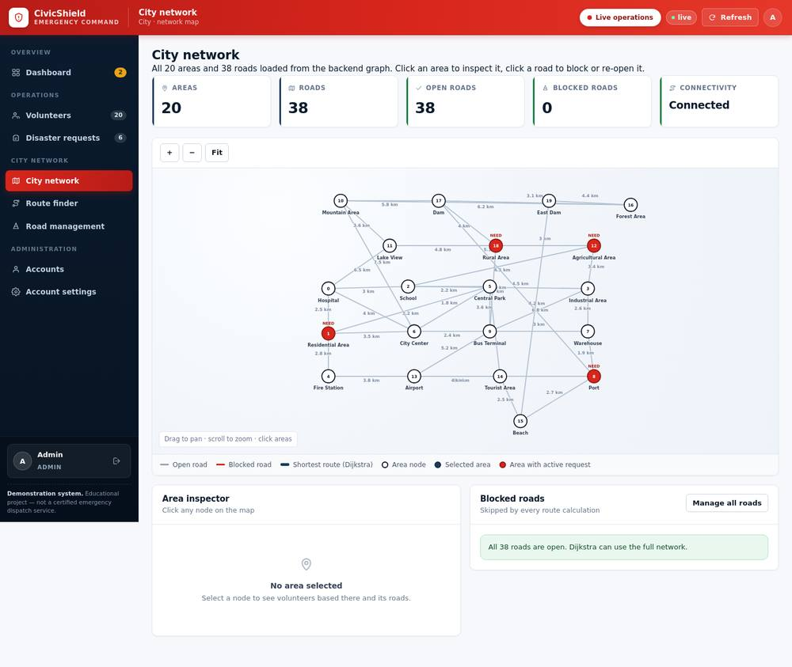 | 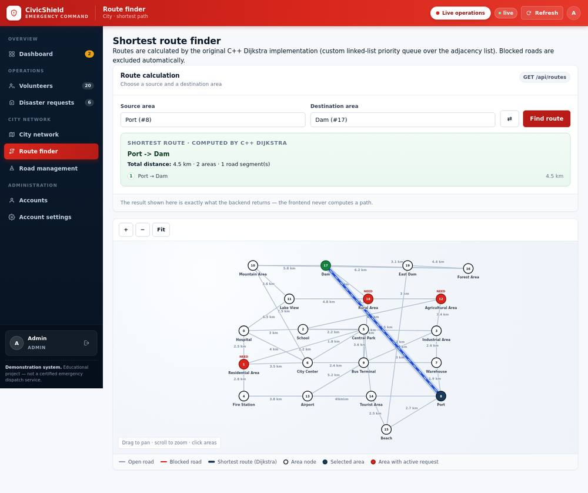 |

| Road management | Accounts |
|---|---|
| 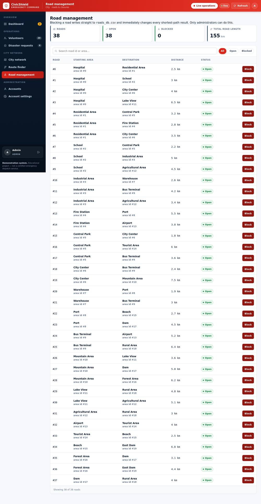 | 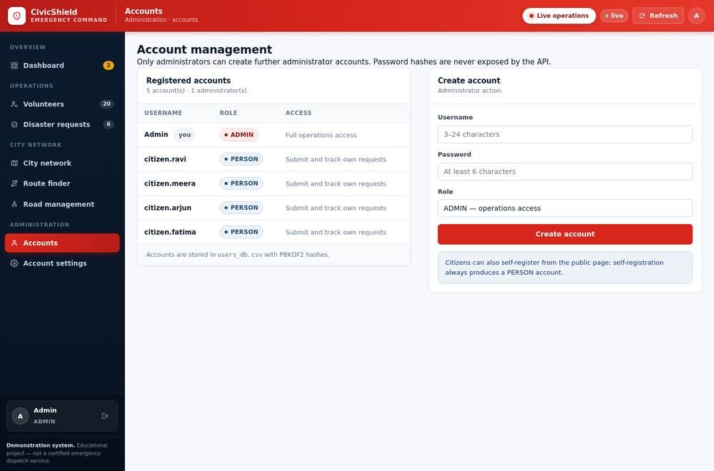 |

| Account settings |
|---|
| 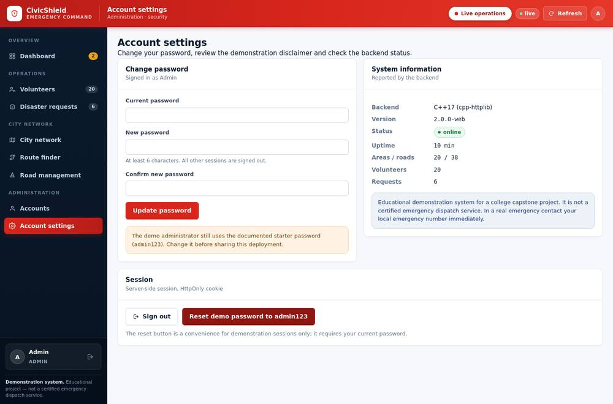 |

## Citizen console

| Overview | Submit request (with dispatch result) | My requests |
|---|---|---|
|  | 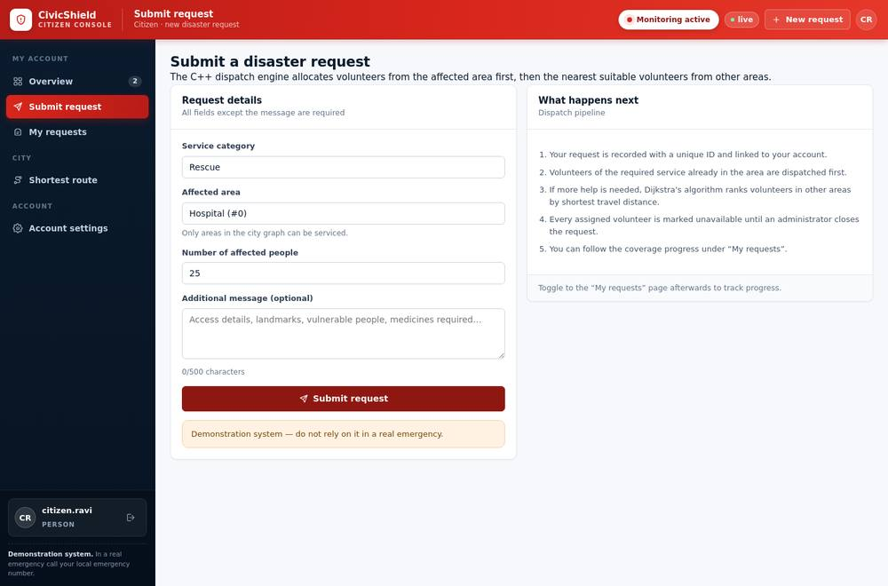 | 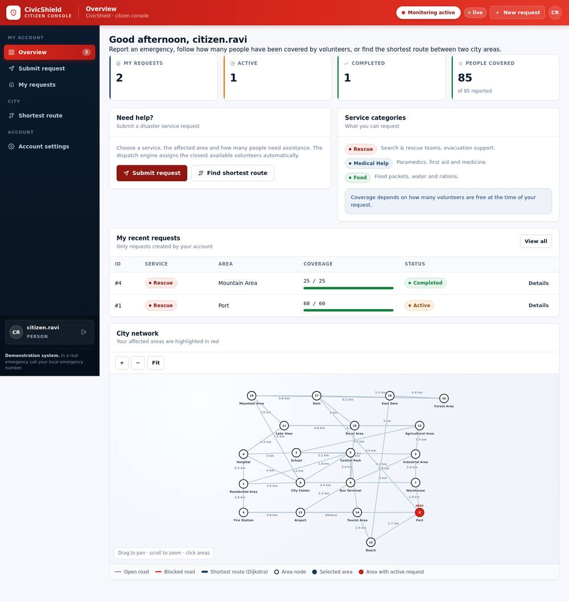 |

## Responsive layout

| Mobile — admin dashboard | Mobile — landing | Tablet — volunteer table |
|---|---|---|
| 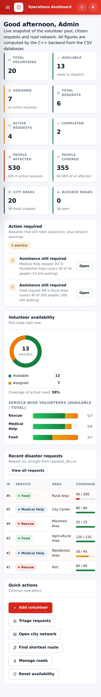 |  | 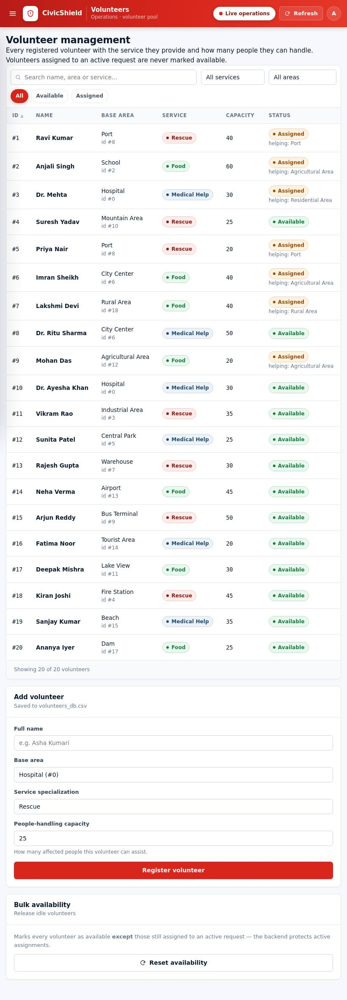 |
